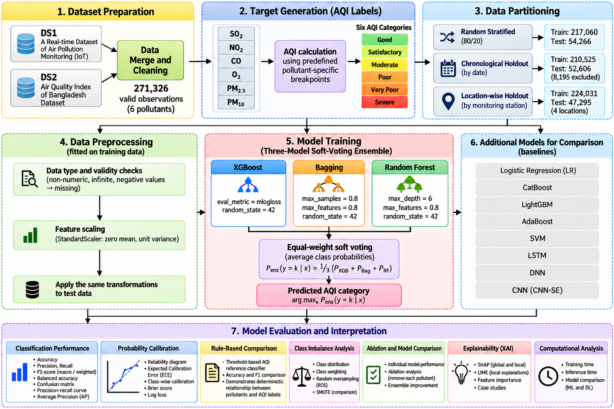

# Explainable Multi-Pollutant AQI Classification Using a Voting Ensemble Framework: Evidence from Bangladesh

## Overview

This repository contains the datasets, Jupyter notebooks, experimental implementations, and evaluation procedures associated with the study **"Explainable Multi-Pollutant AQI Classification Using a Voting Ensemble Framework: Evidence from Bangladesh."**

The proposed approach combines XGBoost, Bagging, and Random Forest through equal-weight soft voting to classify air quality into six AQI categories using six pollutant measurements.

## Proposed Research Workflow

The following figure illustrates the complete experimental workflow, including dataset preparation, AQI label generation, data partitioning, preprocessing, model training, baseline comparison, and evaluation.

**Figure 1.** Overview of the proposed multi-pollutant AQI classification framework.

The workflow consists of seven main stages:

1. **Dataset Preparation:** Merge and clean DS1 and DS2 to obtain 271,326 valid observations.
2. **Target Generation:** Calculate AQI categories using pollutant-specific breakpoints for SO2, NO2, CO, O3, PM2.5, and PM10.
3. **Data Partitioning:** Evaluate random stratified, chronological, and location-wise holdout strategies.
4. **Data Preprocessing:** Perform validity checks, training-only imputation where required, and feature scaling.
5. **Model Training:** Train XGBoost, Bagging, and Random Forest and combine their class probabilities through equal-weight soft voting.
6. **Baseline Comparison:** Compare the ensemble against conventional machine learning and deep learning classifiers.
7. **Model Evaluation and Interpretation:** Conduct classification evaluation, calibration analysis, rule-based comparison, class imbalance analysis, ablation studies, explainability analysis, and computational assessment.

## Original Dataset Sources

**DS1 — A Real-time Dataset of Air Pollution Monitoring Generated Using IoT**

https://doi.org/10.17632/4r25x9sc7k.1

**DS2 — Air Quality Index of Bangladesh Dataset**

https://www.kaggle.com/datasets/tahmidmir/air-quality-index-of-bangladesh-dataset/data

## Experimental Results

| Metric | Proposed Voting Ensemble |
|---|---:|
| Accuracy | 99.9410% |
| Macro Precision | 0.9991 |
| Macro Recall | 0.9989 |
| Macro F1-score | 0.9990 |
| Correct Predictions | 54,234 |
| Incorrect Predictions | 32 |

## Reproducibility

The experiments were implemented in Python using Google Colab. The repository includes notebooks for AQI calculation, data visualization, machine learning baselines, deep learning baselines, ensemble classification, and ablation studies.

To reproduce the experiments, use the merged clean datasets, consistent preprocessing, fixed train–test partitions, and the documented model configurations.

## Citation

If you use this repository, please cite the associated research study and the original dataset sources.
